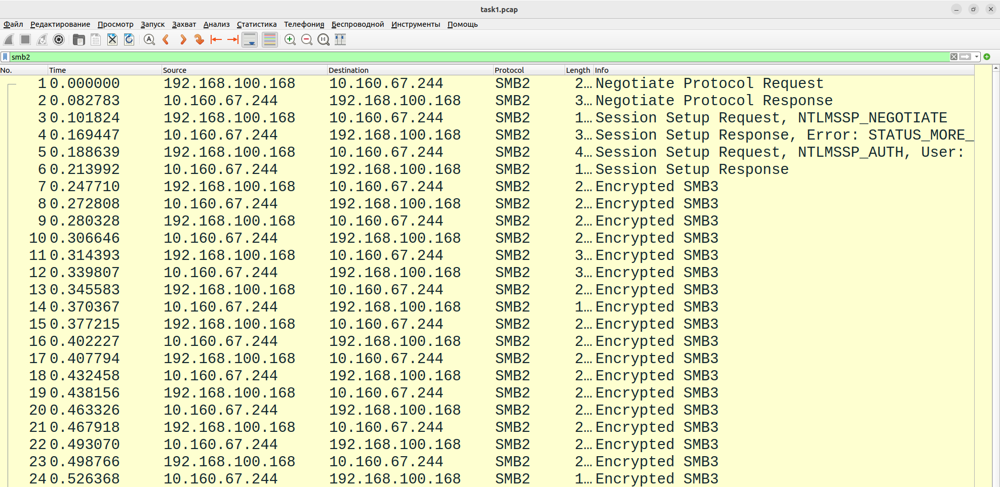
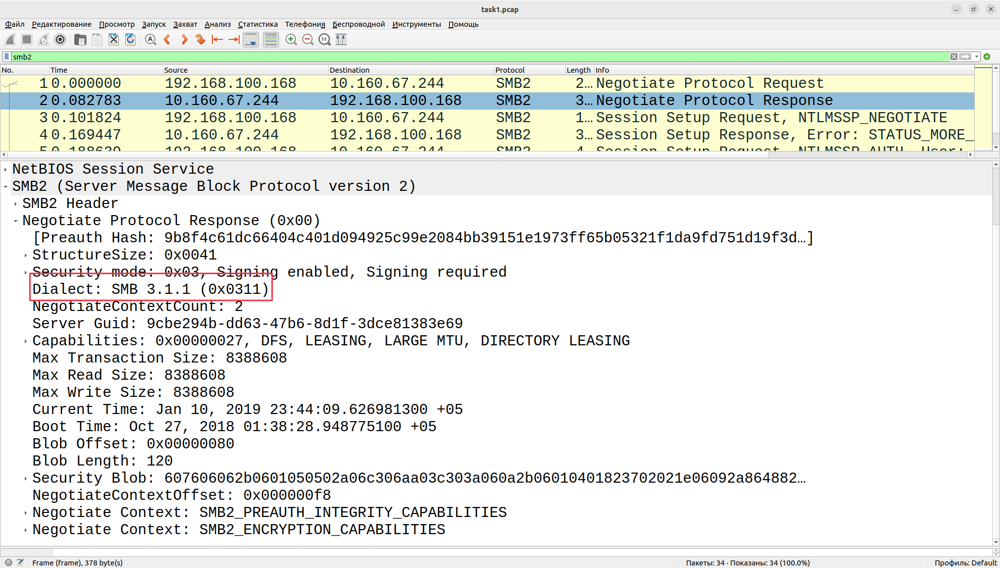
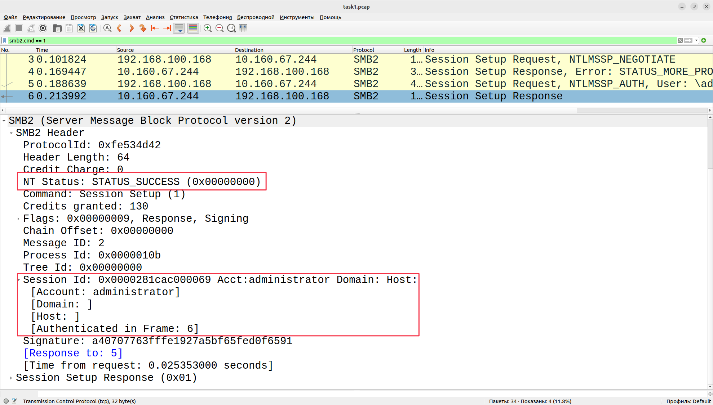
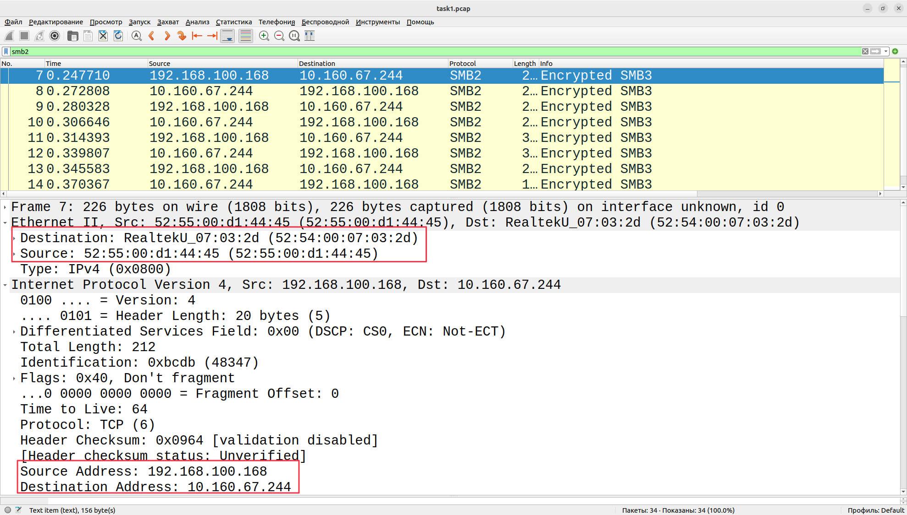
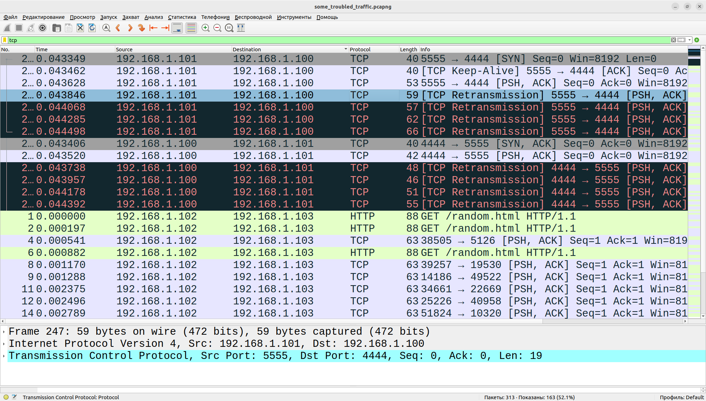
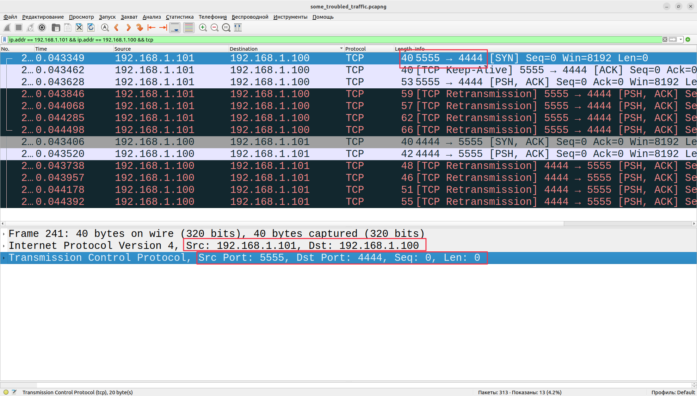
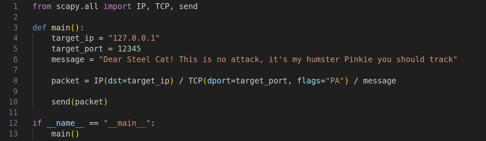
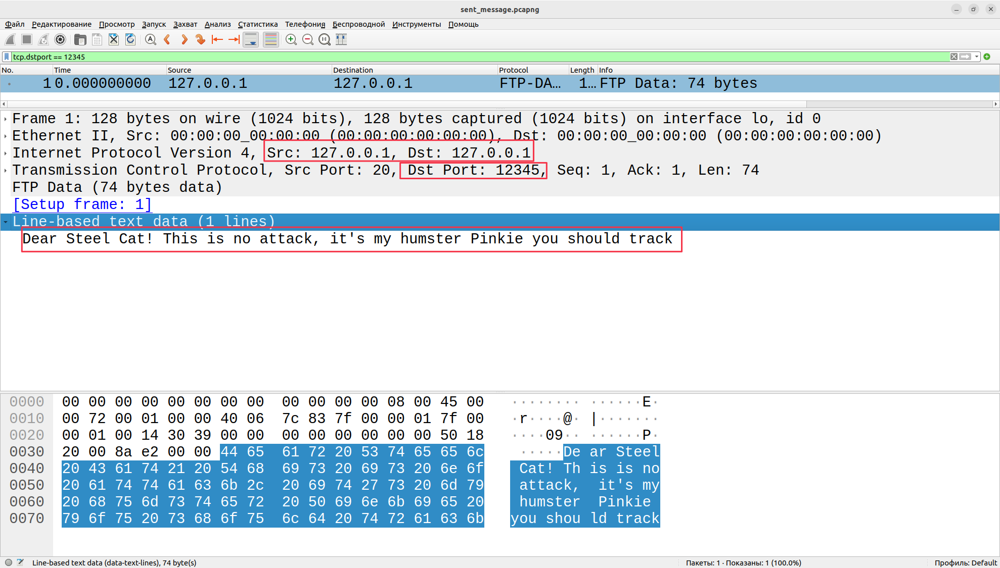

# Technical Report — Wireshark and Network Forensics

## 1. Обзор проекта

Данный проект посвящён исследованию сетевого трафика, анализу сетевых соединений и изучению методов формирования пакетов с использованием Wireshark, Python и Scapy.

В ходе работы выполнены три практических задания:

1. SMB Analysis — исследование SMB-соединения, анализ параметров сессии и аутентификации.
2. Reverse Shell Investigation — поиск и анализ признаков Reverse Shell в сетевом дампе.
3. Scapy Packet Crafting — формирование TCP-пакета с помощью Python и Scapy, его захват и исследование в Wireshark.

## 2. Лабораторное окружение

Работа выполнялась с использованием Wireshark и Python с библиотекой Scapy.

| Компонент | Назначение |
|---|---|
| Wireshark | Захват и анализ сетевого трафика |
| Python | Разработка скрипта для формирования пакетов |
| Scapy | Создание и отправка сетевых пакетов |

Для выполнения заданий использовались предоставленные дампы сетевого трафика и локальное окружение для формирования и захвата пакетов.

---

## 3. SMB Traffic Analysis

### 3.1. Цель

Исследовать предоставленный дамп сетевого трафика, определить используемую версию SMB-диалекта, Session ID установленного соединения, учетную запись участника и MAC-адреса взаимодействующих устройств.

### 3.2. Исходные данные

Для исследования использовался файл `task1.pcap`.

В дампе зафиксировано взаимодействие между SMB-клиентом и сервером.

Участники соединения:

| Устройство | IP-адрес |
|---|---|
| Клиент | 192.168.100.168 |
| Сервер | 10.160.67.244 |

**Общий вид SMB-трафика:**



### 3.3. Анализ SMB-соединения

В дампе обнаружен процесс установления SMB-сессии между клиентом и сервером.

Взаимодействие начинается с согласования параметров протокола, после чего стороны переходят к аутентификации с использованием NTLMSSP.

На первой стадии аутентификации сервер возвращает статус `STATUS_MORE_PROCESSING_REQUIRED` (`0xc0000016`). Это является частью механизма Challenge-Response протокола NTLMSSP и означает, что для завершения аутентификации требуется дополнительный обмен данными.

После успешного ответа клиента сервер возвращает `STATUS_SUCCESS`, присваивает установленной сессии уникальный идентификатор, после чего клиент начинает взаимодействие с ресурсами сервера.

### 3.4. Определение версии SMB

В результате анализа пакета Negotiate Protocol Response определена согласованная версия SMB-диалекта.

| Параметр | Значение |
|---|---|
| SMB Dialect | SMB 3.1.1 |
| Dialect Revision | `0x0311` |

**Результат проверки:**



### 3.5. Определение Session ID и учетной записи

После успешной аутентификации сервер присвоил SMB-сессии уникальный идентификатор.

| Параметр | Значение |
|---|---|
| Session ID | `0x0000281cac000069` |
| Статус сессии | `STATUS_SUCCESS` |
| User name | `administrator` |
| Domain name | `NULL` |

В исследованном соединении использовалась локальная учетная запись `administrator`. Значение поля Domain name было `NULL`.

**Результат проверки:**



### 3.6. Определение MAC-адресов

В Ethernet-заголовках исследованных пакетов определены MAC-адреса взаимодействующих устройств.

| Устройство | IP-адрес | MAC-адрес |
|---|---|---|
| Клиент | 192.168.100.168 | 52:55:00:d1:44:45 |
| Сервер | 10.160.67.244 | 52:54:00:07:03:2d |

**Результат проверки:**



### 3.7. Результат

В ходе исследования SMB-дампа определены:

- Версия SMB-диалекта — SMB 3.1.1.
- Session ID установленного соединения.
- Учетная запись, участвовавшая в аутентификации.
- MAC-адреса клиента и сервера.

Изучены этапы установления SMB-сессии и особенности аутентификации с использованием NTLMSSP.

---

## 4. Reverse Shell Investigation

### 4.1. Цель

Исследовать предоставленный сетевой дамп, обнаружить признаки Reverse Shell и определить IP-адреса участников соединения, используемый протокол и переданные команды.

### 4.2. Исходные данные

Для исследования использовался файл `some_troubled_traffic.pcapng`.

В ходе анализа был обнаружен подозрительный TCP-сеанс между двумя узлами.

Участники соединения:

| Роль | IP-адрес |
|---|---|
| Инициатор соединения | 192.168.1.101 |
| Удалённая сторона | 192.168.1.100 |

Параметры соединения:

| Параметр | Значение |
|---|---|
| Протокол | TCP |
| Порт инициатора | 5555 |
| Порт удалённой стороны | 4444 |

**Общий вид исследуемого TCP-трафика:**



### 4.3. Анализ TCP-сеанса

Для исследования использовались фильтры Wireshark, анализ TCP-пакетов и функция Follow TCP Stream.

Дополнительно содержимое TCP Payload исследовалось непосредственно в ASCII-представлении панели Packet Bytes.

В ходе анализа были определены направление соединения, IP-адреса и TCP-порты взаимодействующих сторон.

**Параметры исследуемого соединения:**



### 4.4. Обнаруженные команды

В исследуемом TCP-потоке обнаружены следующие команды:

```text
id
uname -a
whoami
ls -la /etc
cat /etc/passwd
```

Также в потоке присутствовали строки с результатами, связанными с выполнением соответствующих команд:

```text
Result of: id
Result of: uname -a
Result of: whoami
Result of: ls -la /etc
Result of: cat /etc/passwd
```

### 4.5. Анализ обнаруженной активности

Обнаруженные команды указывают на удалённое взаимодействие с командной оболочкой системы.

Последовательность запросов позволяет определить характер выполнявшихся действий:

- Получение информации о текущем пользователе и его идентификаторе.
- Получение сведений об операционной системе.
- Просмотр информации о пользователях системы.
- Исследование содержимого системного каталога `/etc`.

Совокупность обнаруженных признаков соответствует активности, характерной для Reverse Shell.

### 4.6. Результат

В результате исследования определены:

- IP-адрес узла, инициировавшего соединение.
- IP-адрес удалённой стороны.
- Используемый протокол TCP.
- TCP-порты взаимодействующих сторон.
- Команды, переданные в рамках исследуемого соединения.

Изучены методы поиска признаков удалённого командного взаимодействия и исследования содержимого TCP-потоков.

---

## 5. Scapy Packet Crafting

### 5.1. Цель

Разработать Python-скрипт с использованием Scapy, который формирует и отправляет TCP-пакет с заданным сообщением на локальный адрес `127.0.0.1` и порт `12345`.

После отправки необходимо захватить пакет с помощью Wireshark и сохранить его в файл `sent_message.pcapng`.

### 5.2. Реализация

Для выполнения задания использовалась библиотека Scapy.

Исходный код `main.py`:

```python
from scapy.all import IP, TCP, send

def main():
    target_ip = "127.0.0.1"
    target_port = 12345
    message = "Dear Steel Cat! This is no attack, it's my humster Pinkie you should track"

    packet = IP(dst=target_ip) / TCP(dport=target_port, flags="PA") / message

    send(packet)

if __name__ == "__main__":
    main()
```

В скрипте выполняются следующие действия:

1. Импортируются необходимые компоненты библиотеки Scapy.
2. Задаются IP-адрес назначения и TCP-порт.
3. Формируется текстовое сообщение.
4. Создается IP/TCP-пакет с заданными параметрами и полезной нагрузкой.
5. Сформированный пакет отправляется с помощью функции `send()`.

Используются TCP-флаги `PA` (PSH и ACK).

**Исходный код:**



### 5.3. Анализ сформированного пакета

После отправки пакет был захвачен с помощью Wireshark и сохранён в файл `sent_message.pcapng`.

Параметры сформированного пакета:

| Параметр | Значение |
|---|---|
| IP-адрес назначения | 127.0.0.1 |
| Транспортный протокол | TCP |
| Порт назначения | 12345 |
| TCP-флаги | PSH, ACK |
| Полезная нагрузка | Текстовое сообщение из задания |

Переданное сообщение:

```text
Dear Steel Cat! This is no attack, it's my humster Pinkie you should track
```

В Wireshark исследованы заголовки пакета и содержимое TCP Payload.

**Результат проверки:**



### 5.4. Результат

Разработан Python-скрипт для формирования и отправки IP/TCP-пакета с использованием Scapy.

Получен дамп `sent_message.pcapng`, содержащий один пакет с заданным сообщением.

Изучены принципы формирования сетевых пакетов и проверки их содержимого с помощью Wireshark.

---

## 6. Анализ сетевого трафика и применение в SOC

В рамках проекта изучены методы исследования сетевого взаимодействия, анализа содержимого пакетов и поиска признаков подозрительной активности.

| Технология / навык | Значение для сетевой безопасности |
|---|---|
| SMB Analysis | Исследование SMB-соединений и параметров сетевых сессий |
| NTLMSSP | Анализ процесса сетевой аутентификации |
| TCP Stream Analysis | Исследование содержимого TCP-соединений |
| Reverse Shell Investigation | Поиск признаков удалённого командного взаимодействия |
| Packet Analysis | Исследование заголовков и полезной нагрузки пакетов |
| Scapy | Формирование и автоматизация работы с сетевыми пакетами |
| Wireshark | Ручной анализ сетевого трафика и сетевых артефактов |

Полученные навыки могут применяться при анализе сетевых событий, поиске подозрительной активности, исследовании сетевых артефактов и первичном расследовании инцидентов информационной безопасности.

В рамках проекта не выполнялась интеграция с SIEM, IDS или IPS. Основное внимание уделено ручному исследованию сетевого трафика и анализу содержимого пакетов.

---

## 7. Итоговые результаты

В ходе выполнения проекта:

- Исследован дамп SMB-трафика и определена версия SMB 3.1.1.
- Определены Session ID и учетная запись SMB-сессии.
- Установлены MAC-адреса взаимодействующих устройств.
- Исследован сетевой дамп с признаками Reverse Shell.
- Определены IP-адреса и TCP-порты участников соединения.
- Обнаружены команды, переданные в рамках TCP-сеанса.
- Разработан Python-скрипт с использованием Scapy.
- Сформирован и отправлен IP/TCP-пакет на локальный адрес.
- Выполнен захват и анализ сформированного пакета в Wireshark.
- Результаты исследований сохранены в виде сетевых дампов, исходного кода и документации.

## 8. Полученные навыки

- Анализ сетевого трафика с помощью Wireshark.
- Исследование SMB-соединений и параметров сессий.
- Понимание основ NTLMSSP-аутентификации.
- Анализ структуры TCP-пакетов.
- Исследование содержимого TCP-потоков.
- Поиск признаков Reverse Shell в сетевых дампах.
- Работа с шестнадцатеричным и ASCII-представлением сетевых данных.
- Формирование сетевых пакетов с использованием Python и Scapy.
- Захват и проверка сетевого трафика.
- Основы Network Forensics и анализа сетевых артефактов.
